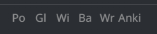
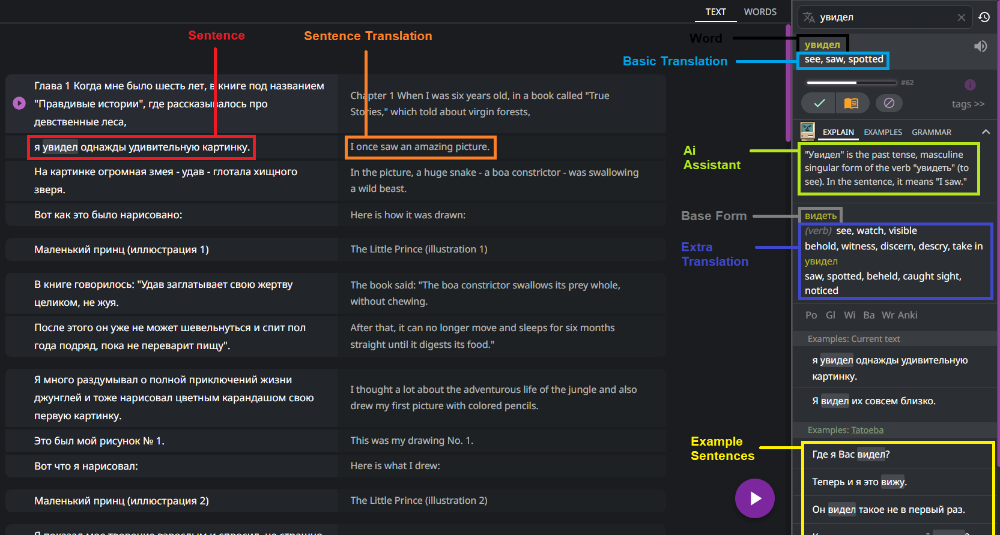
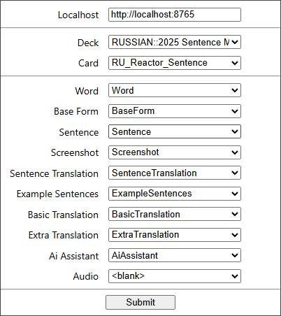
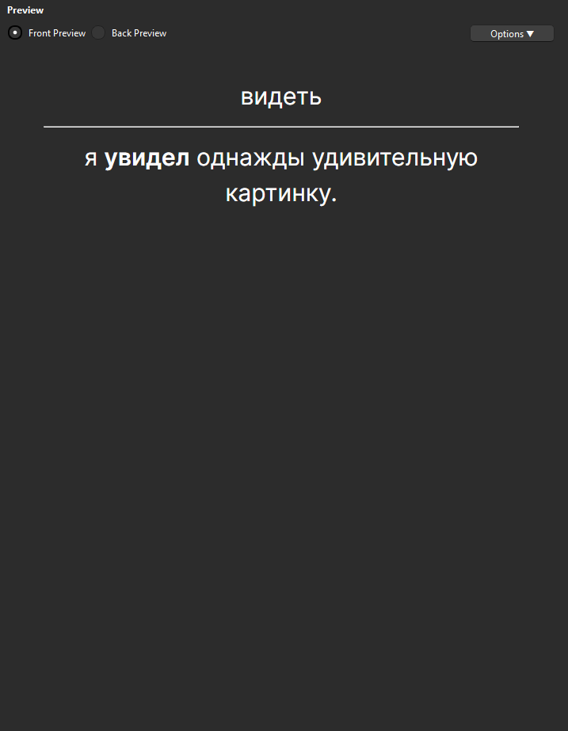
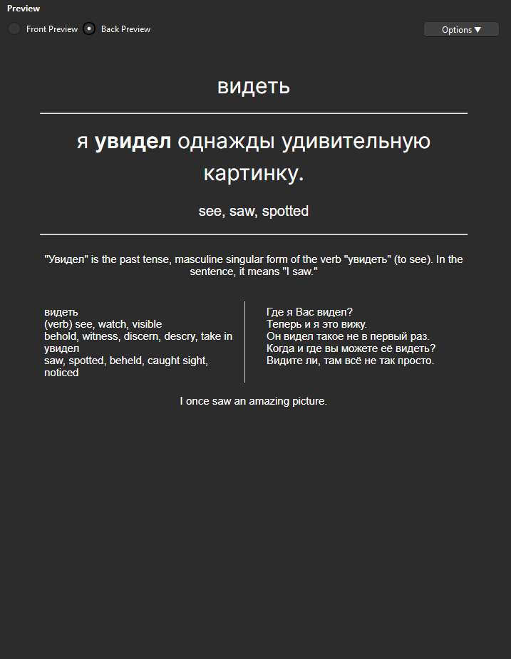

# Language Reactor to Anki

Adds the ability to make flashcards from sentences in the `Youtube`, `Books`, `Video File` and `My Texts` modes.

Currently only tested with Russian. Cards made in the `Youtube` mode do not have screenshots, and Audio is only possible in the `Video File` mode.

## Setup

1) Must install the [AnkiConnect](https://ankiweb.net/shared/info/2055492159) plugin.
2) Download the extension source code: 
    - Blue "code" button then "Download Zip".
    - Unzip the download, to have a folder called "Language_Reactor_to_Anki-master", this is the extension source code.
3) Install the unpacked `Language_Reactor_to_Anki` extension.
    - Open a new chrome tab and go to : <chrome://extensions/>
    - In the top right, toggle ON the "Developer mode".
    - Click "Load Unpacked" and navigate to where the "Language_Reactor_to_Anki-master" folder is, and choose that folder.
4) Setup the URL (default is `http://localhost:8765`), deck and model values, making sure the top field of your note type has a valid value.
5) You **must** leave the Anki desktop application open in order for the extension to communicate with Ankiconnect.

Make sure the field at position 1 in your Anki note type (Tools > Manage Note Types) is set in the extention, if not, then you will get the error "cannot create note because it is empty"

## Usage

Click a word to bring up the definition popup. Clicking the Anki button will gather the relevant data and send it to Anki. 

To change what data is collected, click the extension icon to show the settings page.

Switching video files will require a refresh before adding the new video. 

When audio is needed in `Video File` mode, the extension will replay the subtitle again to collect the audio. Let the video play and wait for the success popup before doing anything else, interrupting the playback may cause a half finished audio track. If the screenshot field is also set, then the screenshot will be taken at the current time of the video before audio recording has started.

The ai field will be filled with whatever Ai mode you have currently selected (Explain, Examples, Grammar).

## Settings

Exported data fields:

 1) `Word` - currently clicked word
 2) `Base Form` - "dictionary" form of the word, without declensions
 3) `Sentence` - sentence in which the currently clicked word is in
 4) `Screenshot` - screenshot is taken at the moment Anki is clicked (only works in `Video File` mode)
 5) `Sentence Translation` - translation of the sentence which is normally on the right
 6) `Example Sentences` - examples given by Tatoeba in the dictionary panel (not current or saved examples)
 7) `Basic Translation` - simple translation of the word
 8) `Extra Translation` - more translation of the current word
 9) `Ai Assistant` - save the text output from the Ai assistant
 10) `Audio` - recording of the audio from the video in `Video File` mode

Settings allow you to choose which fields are filled with what data. A blank options means that data is skipped

## Example card

Front of card 

Back of card 

